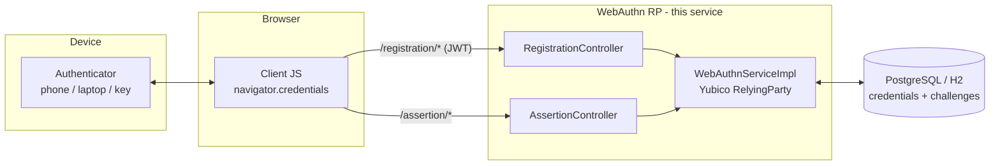
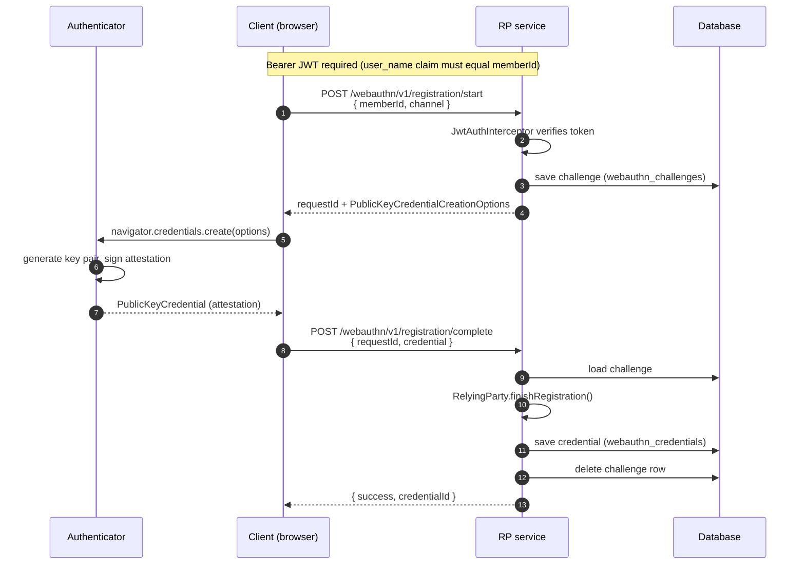
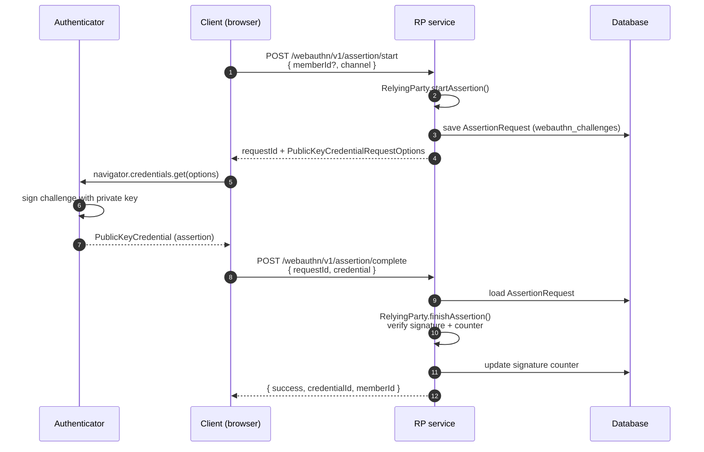

# WebAuthn Infrastructure

Standalone WebAuthn Relying Party (RP) built with Spring Boot 3.3, JDK 17, Gradle, Yubico `webauthn-server-core`, and PostgreSQL (H2 for local dev/tests).

Ported from Hyatt's `svc-digital-webauthn` with all Hyatt-internal dependencies replaced by open-source equivalents.

## About Passkeys & WebAuthn

**WebAuthn** (Web Authentication) is a W3C standard API that lets web applications register and authenticate users with public-key cryptography instead of passwords. It is the browser-facing half of the **FIDO2** specifications maintained jointly by the [W3C](https://www.w3.org/) and the [FIDO Alliance](https://fidoalliance.org/).

A **passkey** is a FIDO2 credential — a public/private key pair bound to a website's domain (the *Relying Party ID*). The private key never leaves the user's authenticator (a phone, laptop, or hardware security key) and is unlocked with a local gesture: biometrics, PIN, or a tap. The server only ever stores the **public** key, so there is no shared secret to phish, leak, or breach.

Three parties cooperate in every ceremony:

| Role | This project | Description |
|---|---|---|
| **Relying Party (RP)** | ✅ this service | The server that registers and verifies credentials |
| **Client** | browser + your frontend | Runs the JavaScript `navigator.credentials` API |
| **Authenticator** | platform/roaming device | Holds the private key and performs the signing gesture |

There are two ceremonies, each a two-step (start → complete) exchange with this RP:

- **Registration (attestation)** — the authenticator creates a new key pair and returns the public key for the RP to store.
- **Assertion (authentication)** — the authenticator proves possession of the private key by signing a server-issued challenge.

Both ceremonies are built on a fresh, single-use, server-generated **challenge** to defend against replay. This service persists that challenge (and, for assertions, the full Yubico `AssertionRequest`) in `webauthn_challenges` between the two steps.

### Official documentation

- [W3C Web Authentication Level 2 (WebAuthn) spec](https://www.w3.org/TR/webauthn-2/)
- [FIDO Alliance — Passkeys overview](https://fidoalliance.org/passkeys/)
- [MDN — Web Authentication API](https://developer.mozilla.org/en-US/docs/Web/API/Web_Authentication_API)
- [passkeys.dev — developer guide](https://passkeys.dev/)
- [Yubico `java-webauthn-server` (the library this RP is built on)](https://developers.yubico.com/java-webauthn-server/)
- [WebAuthn Guide (interactive walkthrough)](https://webauthn.guide/)

## Package Structure

```
com.greg.webauthn
├── config/       # SecurityConfig, WebAuthnConfig (RelyingParty bean), JacksonConfig, OpenAPIConfig
├── controllers/  # RegistrationController, AssertionController, WebAuthnManagementController
├── interceptor/  # JwtAuthInterceptor, BufferedServletRequestWrapper
├── filter/       # WebFilter (multi-read request body wrapper)
├── security/     # JwtUtil (HMAC-256 Bearer verification)
├── service/      # IWebAuthnService, ICredentialStoreService + impls
├── repositories/ # Spring Data JPA repos + Yubico CredentialRepository bridge
├── validator/    # Grouped request validation (EmptyCheck → FormatCheck → Default)
├── model/        # domain, entity, request, response DTOs
├── exception/    # WebAuthnException, ErrorJson, error enum + handler
└── utils/        # RequestIdUtils, deserializers, enums
```

## API Endpoints

| Endpoint             | Method | Path                                  | Auth       |
|----------------------|--------|---------------------------------------|------------|
| Registration start   | POST   | `/webauthn/v1/registration/start`     | JWT        |
| Registration complete| POST   | `/webauthn/v1/registration/complete`  | JWT        |
| Assertion start      | POST   | `/webauthn/v1/assertion/start`        | none       |
| Assertion complete   | POST   | `/webauthn/v1/assertion/complete`     | none       |
| List credentials     | GET    | `/webauthn/v1/credentials?memberId=`  | none       |
| Delete credentials   | DELETE | `/webauthn/v1/credentials?memberId=`  | JWT        |
| Delete credentials v2| DELETE | `/webauthn/v2/credentials?memberId=`  | HTTP Basic |
| Health               | GET    | `/health`                             | none       |
| Info                 | GET    | `/info`                               | none       |
| Swagger UI           | GET    | `/swagger-ui.html`                    | none       |
| H2 console (dev)     | GET    | `/h2-console`                         | none       |

## Prerequisites

- JDK 17
- PostgreSQL (or Docker) — **only for the `prod` profile**; the default profile uses H2 in-memory and needs no database

## Quick Start

The default profile runs entirely in-memory (H2) — no database setup required.

```bash
./gradlew bootRun
```

Once started:
- **Service** → http://localhost:8080
- **Swagger UI** → http://localhost:8080/swagger-ui.html
- **H2 console** → http://localhost:8080/h2-console (JDBC URL `jdbc:h2:mem:webauthndb`, user `sa`, no password)

The Relying Party is seeded from `application.properties`:
- **RP ID**: `localhost`
- **RP name**: `webauthn-infrastructure`
- **Allowed origin**: `http://localhost:8080`

Credential and challenge tables are created on startup (`ddl-auto=create-drop`) and dropped on shutdown.

---

## Running Locally — Detailed Steps

### 1. Verify your JDK

```bash
java -version   # must report 17.x
```

If you manage multiple JDKs, point `JAVA_HOME` at a 17 install before running Gradle:

```bash
export JAVA_HOME=$(/usr/libexec/java_home -v 17)   # macOS
```

### 2. Start the service (H2, default profile)

```bash
./gradlew bootRun
```

Wait for the log line `Started Application in N seconds`. Confirm it's healthy:

```bash
curl -s http://localhost:8080/health | jq
# → { "status": "UP" }
```

### 3. Mint a JWT for the protected endpoints

Registration endpoints and `DELETE /webauthn/v1/credentials` are guarded by `JwtAuthInterceptor`. It verifies an **HMAC-256** Bearer token and checks that the token's `user_name` claim equals the `memberId` in the request.

The signing secret is `jwt.secret` in `application.properties` (default `changeme-replace-with-a-long-random-string-in-production`).

Generate a token whose `user_name` matches the `memberId` you'll register (`member1` below). Any HS256 tool works — here's a self-contained Python snippet using the same secret:

```bash
python3 - <<'PY'
import hmac, hashlib, base64, json, time
secret = b"changeme-replace-with-a-long-random-string-in-production"
def b64(b): return base64.urlsafe_b64encode(b).rstrip(b"=")
header  = b64(json.dumps({"alg":"HS256","typ":"JWT"}).encode())
payload = b64(json.dumps({"user_name":"member1","exp":int(time.time())+3600}).encode())
sig     = b64(hmac.new(secret, header+b"."+payload, hashlib.sha256).digest())
print((header+b"."+payload+b"."+sig).decode())
PY
```

Capture it in a shell variable:

```bash
TOKEN=$(python3 - <<'PY'
import hmac, hashlib, base64, json, time
secret = b"changeme-replace-with-a-long-random-string-in-production"
def b64(b): return base64.urlsafe_b64encode(b).rstrip(b"=")
h = b64(json.dumps({"alg":"HS256","typ":"JWT"}).encode())
p = b64(json.dumps({"user_name":"member1","exp":int(time.time())+3600}).encode())
s = b64(hmac.new(secret, h+b"."+p, hashlib.sha256).digest())
print((h+b"."+p+b"."+s).decode())
PY
)
echo "$TOKEN"
```

> **Note:** `memberId` must be 1–64 alphanumeric characters (see `MemberIdValidator`). `channel` must be one of `WEB`, `MOBILE`, `IOS`, `ANDROID`, `TABLET` (see `ChannelsValidator`).

### 4. Start a registration

```bash
curl -s -X POST http://localhost:8080/webauthn/v1/registration/start \
  -H "Authorization: Bearer $TOKEN" \
  -H "Content-Type: application/json" \
  -d '{"memberId":"member1","channel":"WEB"}' | jq
```

The response contains a `requestId` and `PublicKeyCredentialCreationOptions`. A browser/authenticator would pass those options to `navigator.credentials.create()`, then post the result to `/registration/complete`.

### 5. Complete registration (from a browser client)

Registration and assertion **completion** require a real authenticator response (`navigator.credentials.create()` / `.get()`), so they can't be exercised with `curl` alone. Use the Swagger UI or a WebAuthn test client (e.g. a small HTML page calling the browser WebAuthn API) served from `http://localhost:8080` so the origin matches the RP configuration.

### 6. List a member's credentials (no auth)

```bash
curl -s "http://localhost:8080/webauthn/v1/credentials?memberId=member1" | jq
```

### 7. Delete a member's credentials (JWT)

```bash
curl -s -X DELETE "http://localhost:8080/webauthn/v1/credentials?memberId=member1" \
  -H "Authorization: Bearer $TOKEN"
```

### 8. Delete via v2 (HTTP Basic instead of JWT)

The v2 delete uses HTTP Basic auth (`spring.security.user.name` / `spring.security.user.password`, default `admin` / `changeme`):

```bash
curl -s -X DELETE "http://localhost:8080/webauthn/v2/credentials?memberId=member1" \
  -u "admin:changeme"
```

### 9. Run against PostgreSQL instead of H2

Start Postgres:

```bash
docker run -d --name webauthn-pg \
  -e POSTGRES_DB=webauthn \
  -e POSTGRES_USER=webauthn \
  -e POSTGRES_PASSWORD=webauthn \
  -p 5432:5432 postgres:16
```

Provide a `prod`-profile datasource (create `src/main/resources/application-prod.properties`):

```properties
spring.datasource.url=jdbc:postgresql://localhost:5432/webauthn
spring.datasource.username=webauthn
spring.datasource.password=webauthn
spring.datasource.driver-class-name=org.postgresql.Driver
spring.jpa.database-platform=org.hibernate.dialect.PostgreSQLDialect
spring.jpa.hibernate.ddl-auto=update
```

Run with that profile:

```bash
./gradlew bootRun --args='--spring.profiles.active=prod'
```

---

## End-to-End Flow

The diagrams below use [Mermaid](https://mermaid.js.org/) and render inline on GitHub. Both ceremonies involve four actors: the **Authenticator** (device), the **Client** (browser + your frontend), this **RP service**, and the **Database**.

### High-level overview



### Registration ceremony (attestation)

A new passkey is created; the RP stores the resulting **public key**.



### Assertion ceremony (authentication / login)

An existing passkey proves possession by signing the server challenge.



## Persistence

| Entity                     | Table                  | Description                                  |
|----------------------------|------------------------|----------------------------------------------|
| `WebAuthnCredentialEntity` | `webauthn_credentials` | One row per registered passkey               |
| `WebAuthnChallengeEntity`  | `webauthn_challenges`  | Short-lived challenge (deleted after complete)|

`CredentialStoreServiceImpl` wraps both JPA repositories. `WebAuthnCredentialRepository` implements Yubico's `CredentialRepository` interface and bridges it to `ICredentialStoreService`. Assertion challenges are serialized as a full Yubico `AssertionRequest` (`toJson()` / `fromJson()`); registration challenges use `PublicKeyCredentialCreationOptions.toJson()` / `fromJson()`.

---

## Running Tests

```bash
./gradlew test                                       # unit tests
./gradlew jacocoTestReport                            # coverage report (HTML in build/reports/jacoco/test/html/)
./gradlew test --tests "*.WebAuthnServiceImplTest"    # single class
```

Jacoco enforces a **90%** line-coverage minimum; `config`, `model`, `exception`, and `Application` are excluded.

## Configuration

All tunable values live in `src/main/resources/application.properties`. Override per environment via environment variables or a secrets manager — **never commit real secrets**.

| Property                            | Default                          | Purpose                                          |
|-------------------------------------|----------------------------------|--------------------------------------------------|
| `server.port` (implicit)            | `8080`                           | HTTP listen port                                 |
| `webauthn.relying.party.id`         | `localhost`                      | RP effective domain (no scheme/port)             |
| `webauthn.relying.party.name`       | `webauthn-infrastructure`        | Human-readable RP name                           |
| `webauthn.relying.party.origins`    | `http://localhost:8080`          | Allowed origins (comma-separated)                |
| `jwt.secret`                        | `changeme-...`                   | HMAC-256 secret for Bearer token verification    |
| `request.id.hash.salt`              | `changeme-salt`                  | Salt for SHA-256 `requestId` generation          |
| `spring.security.user.name`         | `admin`                          | HTTP Basic user (v2 delete, `/_ops/*`)           |
| `spring.security.user.password`     | `changeme`                       | HTTP Basic password                              |
| `spring.datasource.*`               | H2 in-memory                     | Datasource (override in `prod` profile)          |

---

## Production / Enterprise TODO

### Security (Critical)
- [ ] Enforce HTTPS / TLS — service runs plain HTTP
- [ ] Replace the HMAC-256 shared secret with asymmetric signing (RS256/ES256) for JWT verification, or verify tokens against the issuing authorization server's JWKS
- [ ] Remove hardcoded `changeme` secrets (`jwt.secret`, `request.id.hash.salt`, Basic-auth password) — source from env/secrets manager; fail fast if unset outside dev
- [ ] Protect `/webauthn/v1/assertion/start` and `/credentials` GET — add rate limiting and enumeration protection (they currently accept unauthenticated `memberId` lookups)
- [ ] Add brute-force / abuse protection on the assertion and registration endpoints
- [ ] Add a challenge cleanup job — expired `webauthn_challenges` rows are only deleted on successful completion; add TTL-based pruning

### Security (Important)
- [ ] Validate and pin allowed origins per environment (`webauthn.relying.party.origins`)
- [ ] Tighten `MemberIdValidator` regex to your real member-ID format (currently 1–64 alphanumeric)
- [ ] Enforce signature-counter regression checks and surface clone-detection signals from Yubico's `AssertionResult`
- [ ] Restrict the H2 console and Swagger UI to non-prod profiles

### Reliability & Ops
- [ ] Add readiness/liveness probes distinct from the aggregate `/health`
- [ ] Add Micrometer + Prometheus metrics (registration/assertion rates, failure breakdown, challenge TTL expiries)
- [ ] Add distributed tracing (Micrometer Tracing / OpenTelemetry)
- [ ] Configure the PostgreSQL connection pool size and timeouts explicitly
- [ ] Configure graceful shutdown (`server.shutdown=graceful`)
- [ ] Switch `ddl-auto` off in prod and manage schema with Flyway/Liquibase

### Multi-instance / HA
- [ ] Ensure challenge storage works across pods (it already uses the shared DB — verify no in-memory assumptions)
- [ ] Replace in-memory form-login/session state (if any UI is added) with Spring Session + Redis or JDBC

### Observability & Auditability
- [ ] Structured JSON logging (Logstash encoder) for log aggregation (ELK, Datadog, etc.)
- [ ] Audit log — record registrations, assertions, credential deletions, and failed auth attempts to a structured store
- [ ] Emit application events on credential lifecycle changes for alerting

### Configuration & Deployment
- [ ] Separate `application-prod.properties` with secrets externalized (Spring Cloud Config, AWS Parameter Store, k8s Secrets)
- [ ] Dockerfile + `docker-compose.yml` (app + PostgreSQL) for local dev
- [ ] Helm chart or k8s manifests for production
- [ ] CI/CD pipeline (GitHub Actions) — build, test, image push, deploy
- [ ] Dependency vulnerability scanning (OWASP dependency-check or Dependabot); consolidate the manual CVE pins in `build.gradle`

### Testing
- [ ] Integration tests for the full registration and assertion flows using a virtual authenticator (e.g. WebAuthn4J test vectors or `webauthn-server-core` test fixtures)
- [ ] Unit tests for `CredentialStoreServiceImpl` serialization round-trips (registration + assertion)
- [ ] Tests for `JwtAuthInterceptor` (missing token, expired token, `memberId` mismatch)
- [ ] Raise coverage to the enforced 90% minimum (currently ~29%)
- [ ] Load/soak tests for the assertion endpoint
